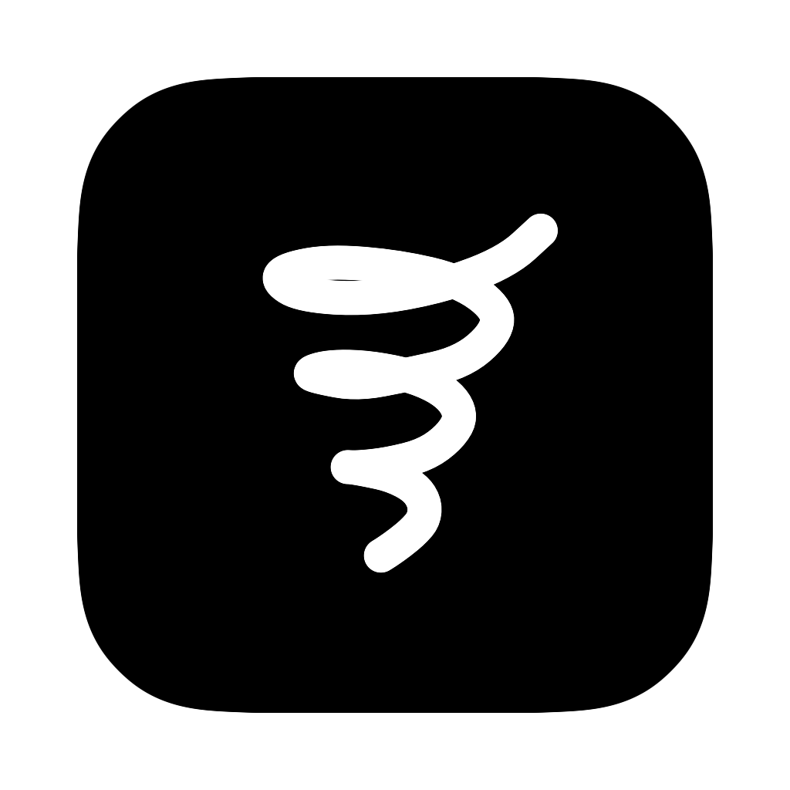
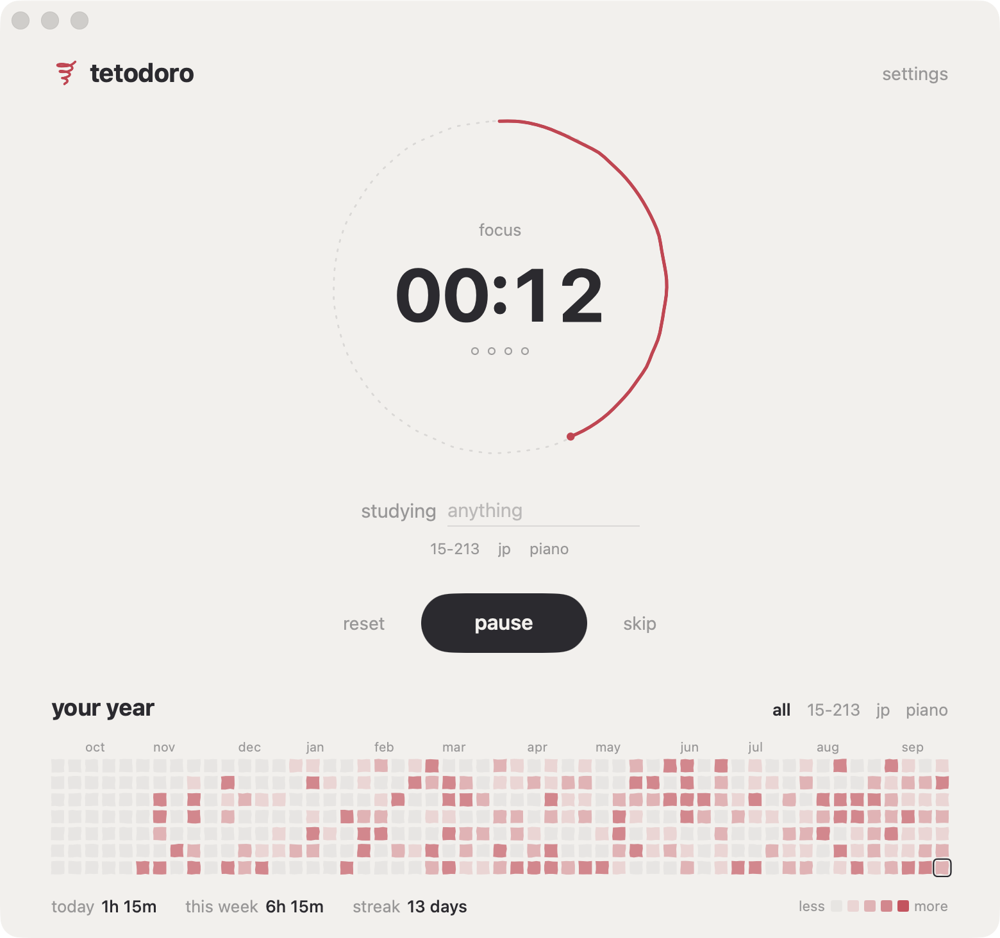
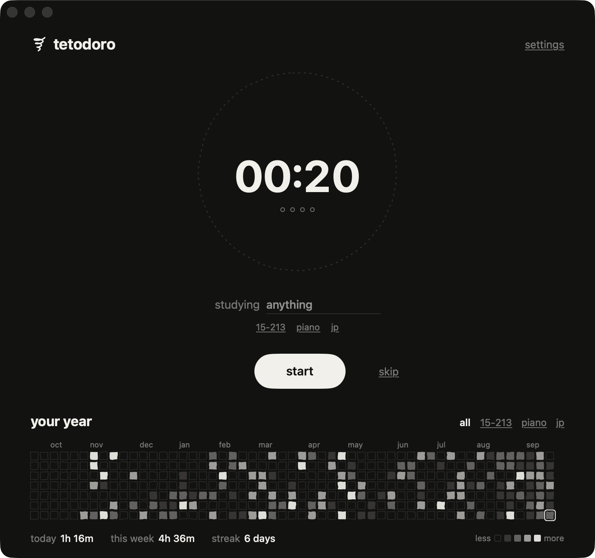

<p align="center"></p>

<h1 align="center">drill</h1>

<p align="center">
  <a href="https://github.com/mmerioles/drill/releases/latest"></a>
  <a href="https://github.com/mmerioles/drill/actions/workflows/release.yml"></a>
  
  
  
</p>

<p align="center">
  a quiet pomodoro timer<br>
  <a href="https://mmerioles.github.io/drill/"><b>mmerioles.github.io/drill</b></a>
</p>

<p align="center">
  
  
</p>

## install

download from **[mmerioles.github.io/drill](https://mmerioles.github.io/drill/)**. it picks the right file for your device.

- **mac**: open the .dmg, drag drill into applications.
- **windows**: run the installer. if windows warns you: more info → run anyway.
- **android**: open the .apk and allow installs if asked.

updates install themselves.

## sync

press sync and sign in. to use your own server instead:

```sh
docker run -d -p 8080:8080 -v drill-data:/data ghcr.io/mmerioles/drill:latest
```

then put its address under server in settings. details in [docs/SYNC.md](docs/SYNC.md).

## repo

`mac/` · `windows/` · `android/` · `ios/` · `web/` (web app, sync server, site) · `shared/` · `docs/` · `supabase/`

## shortcuts

`space` start/pause · `⌘/ctrl →` skip · `⌘/ctrl R` reset · `⌘/ctrl ,` settings
